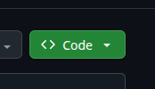

# ChromeProxy
Easy setup, for a fully-featured Google Chrome in your browser. Also comes with terminal environment.

## Get started
Create a codespace of this repository by clicking the dropdown under the **Code** button, selecting the **Codespaces** tab. Wait for it to be set up.

> The **Code** button is a green one at the top.
>
> 
>
> Then you should be able to create a codespace with the next green button.
>
> 
<br>

Enter the codespace, and run the following command in the *Terminal*:
```bash
chmod +x startup.sh
./startup.sh
```
Then go to *Ports* and right-click on the forwarded port. Change the protocol to "HTTPS." Then you're all set.


### Tip
Afterwards, you can simply run `./startup.sh` to restart your session.

## FAQs

### Why is it taking so long?
Be patient. That's all you need. First setup will take longer, the times after that will be much faster. Do not attempt to end the download early.

## Versions

### v1
Docker image, unfortunately doesn't save data

### v2
Keepalive script, with session saving (only saves Google Account info)

### v3
Reveal terminal and session status. Enter terminal by pressing Control+C (^C) in terminal inside graphics output.